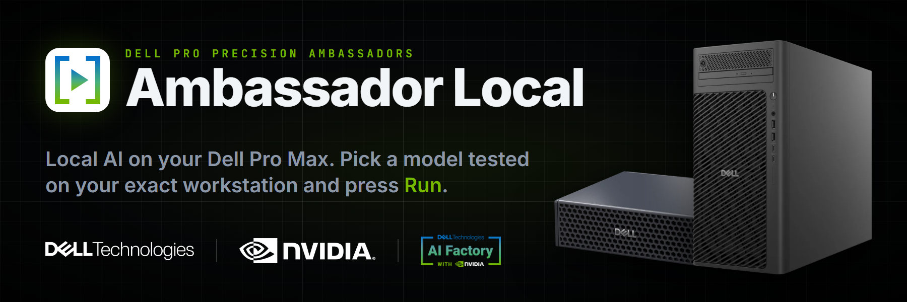
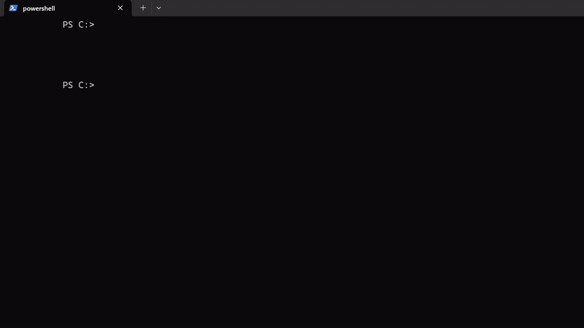
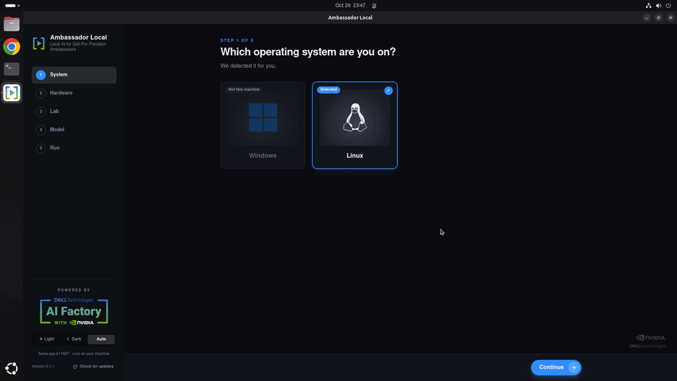
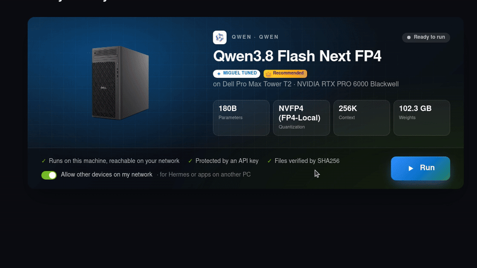
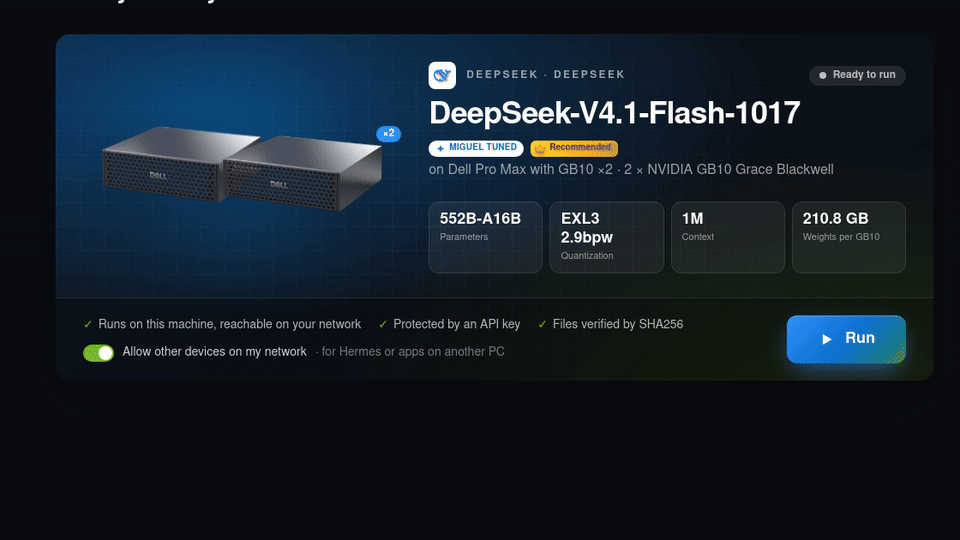
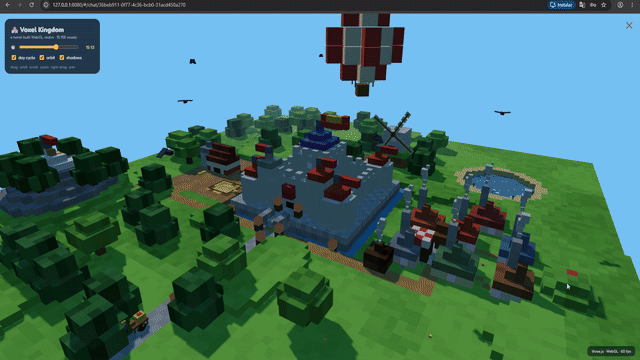
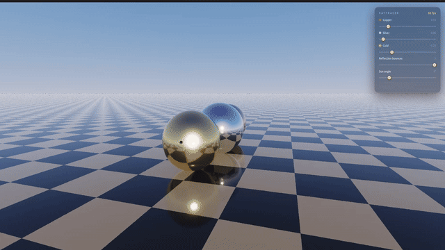
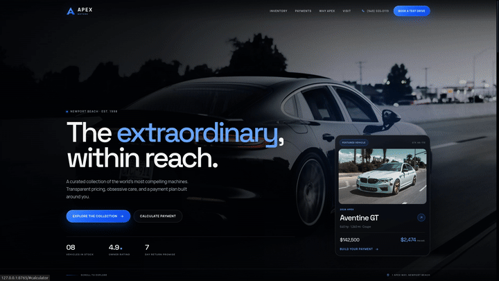

<p align="center">
  
</p>

<p align="center">
  <a href="https://github.com/MangelZabalaDevelop/ambassador-local/releases/latest"></a>
  
  <a href="LICENSE"></a>
</p>

**Ambassador Local** runs AI models on your own Dell Pro Max, built for the **Dell Pro Precision Ambassador** community.
It recognizes your workstation, shows only the models tested on that exact machine, and starts them with one click.
You get a private, OpenAI-compatible endpoint protected by an API key. No cloud, no telemetry.

> **Community project** by a Dell Pro Precision Ambassador. It is not a Dell or NVIDIA product, is not endorsed by them,
> and is not covered by Dell support. Free and open source under the [MIT License](LICENSE).

| Workstation | What you get |
|---|---|
| **Dell Pro Max Tower T2** · RTX PRO 6000 Blackwell (Windows, Ubuntu) | llama.cpp recipes, plus **Miguel Tuned** recipes on Ubuntu (Qwen3.8 Flash Next in NVIDIA FP4 at ~190 tokens/s) |
| **Dell Pro Max with GB10** · DGX OS | Models up to ~120B on one GB10 |
| **Two Dell Pro Max with GB10**, linked over ConnectX | One model across both, up to DeepSeek-V4.1-Flash-1017 (552B) |
| **Dell Pro Max 18 Plus** · up to RTX PRO 5000 Blackwell 24 GB | Not tested yet: shown as *Coming soon* |
| **Dell Pro Max 16 Premium** · up to RTX PRO 3000 Blackwell 12 GB | Not tested yet: shown as *Coming soon* |

Every recipe is tested on the workstation it is listed for: see [Tested on](#tested-on).

## Get started in three steps

### 1. Install



**Windows:** open PowerShell and paste

```powershell
irm https://raw.githubusercontent.com/MangelZabalaDevelop/ambassador-local/main/install.ps1 | iex
```

**Linux** (Pro Max Tower T2 with Ubuntu, GB10 with DGX OS): open a terminal and paste

```bash
curl -fsSL https://raw.githubusercontent.com/MangelZabalaDevelop/ambassador-local/main/install.sh | bash
```

The script downloads the latest release for your system, checks its SHA256 against the one GitHub publishes, and installs it
(Windows: for your user, no admin; Linux: with `apt`, which asks for your password). Then open **Ambassador Local** from the
Start menu or the app menu.

### 2. Pick a model



**System → Workstation → Lab → Model.** Your system and workstation are detected for you, and every model shows the
speed measured on that workstation. **Miguel Tuned** marks recipes tuned and tested by hand; the crown marks the
recommended one.

### 3. Press Run



The app downloads what it needs (verified by SHA256), loads the model on the GPU and shows **Live**. The same button
starts the biggest recipes, even across two GB10:



## Use it

When it says **Live**, the card below shows everything you need:

- **Endpoint URL** and **API key**: paste them into any OpenAI-compatible app. The key stays the same every time.
- **Open chat** (llama.cpp models): a chat page in your browser.
- **Hermes:** run `hermes setup`, choose *Custom OpenAI-compatible endpoint*, then paste the URL and the key.
- **OpenCode** and other coding agents: add an OpenAI-compatible provider with the same URL and key. For example, in `opencode.json`:

```json
{
  "provider": {
    "local": {
      "npm": "@ai-sdk/openai-compatible",
      "options": { "baseURL": "http://127.0.0.1:8080/v1", "apiKey": "{env:AMBASSADOR_KEY}" },
      "models": { "qwen38-flash-next-fp4": {} }
    }
  },
  "model": "local/qwen38-flash-next-fp4"
}
```

Use the port from the endpoint URL and the model id the app shows; put the API key in `AMBASSADOR_KEY`.

### What it can build

Real results, each from a single prompt, recorded on the workstations above:

| Voxel kingdom · Qwen3.8 27B · T2 (Windows) | Ray tracer in 1:59 · Qwen3.8 Flash Next FP4 · T2 (Ubuntu) | Dealership site · DeepSeek-V4.1 · two GB10 |
|---|---|---|
|  |  |  |

## Tested on

Each recipe is tuned and measured on the workstation in its column; the number is the average speed measured there.
A model only appears in the app on the workstations marked here.

<!-- models:start -->
| Model | Pro Max Tower T2 | Pro Max 18 Plus (not tested yet) | Pro Max 16 Premium (not tested yet) | GB10 | GB10 ×2 |
| --- | --- | --- | --- | --- | --- |
| NVIDIA · **Nemotron 3.5 Super VL** 120B-A12B | — | — | — | ✓ 27.9 tok/s | — |
| NVIDIA · **Nemotron 3.5 Bolt** 74B-A9B | ✓ 111.1 tok/s | — | — | ✓ 21.9 tok/s | — |
| NVIDIA · **Nemotron 3.5 Lightning** 30B-A3B | ✓ 341.7 tok/s | — | — | ✓ 81 tok/s | — |
| Qwen · **Qwen3.8 Flash Next** 180B | ✓ 116.9 tok/s | — | — | ✓ 29.2 tok/s | ✓ 30.3 tok/s |
| Qwen · **Qwen3.6 35B-A3B** | ✓ 327.7 tok/s | — | — | ✓ 84.8 tok/s | — |
| Qwen · **Qwen3.8 27B** | ✓ 85.6 tok/s | — | — | ✓ 22.4 tok/s | — |
| Qwen · **Qwen3-Coder-Next** 80B-A3B | ✓ 203.7 tok/s | — | — | ✓ 54.3 tok/s | — |
| Google · **Gemma 4 31B** | ✓ 106.5 tok/s | — | — | ✓ 34 tok/s | — |
| Google · **Gemma 4 26B-A4B** | ✓ 315.4 tok/s | — | — | ✓ 120.5 tok/s | — |
| Google · **Gemma 4 12B** | ✓ 209.5 tok/s | — | — | ✓ 76.3 tok/s | — |
| GLM · **GLM-4.7-Flash** 30B-A3B | ✓ 168.1 tok/s | — | — | ✓ 69.1 tok/s | — |
| GLM · **GLM-5.3-Flash** 320B-A18B | — | — | — | — | ✓ 17.3 tok/s |
| DeepSeek · **DeepSeek V4 Flash** 284B-A13B | — | — | — | ✓ 17 tok/s | ✓ 15.7 tok/s |
| OpenAI · **gpt-oss-120b** 117B-A5B | ✓ 203.3 tok/s | — | — | ✓ 43 tok/s | — |
| Google · **Gemma 3 12B** | ✓ 91 tok/s | — | — | ✓ | — |
| Qwen · **Qwen3.8 Flash Next FP4** 180B | ✓ 191.5 tok/s · Miguel Tuned | — | — | — | — |
| DeepSeek · **DeepSeek-V4.1-Flash-1017** 552B-A16B | — | — | — | — | ✓ 53.9 tok/s · Miguel Tuned |
<!-- models:end -->

### Share a recipe

Have one of these workstations and a recipe that works well on it? Open an
[issue](https://github.com/MangelZabalaDevelop/ambassador-local/issues/new) with the model, the settings and the speed you
measured, send a pull request (see [Adding recipes](#adding-recipes)), or email it to
[m.zabala@xpectra.ai](mailto:m.zabala@xpectra.ai). It gets reviewed and added to the next update,
marked with the workstation it was tested on.

## Security

- **Network access is your choice.** With *Allow other devices on my network* (on by default, so Hermes or other apps on another PC can connect) the server listens on your local network; turn it off and it listens on **127.0.0.1 only**. Either way every request needs the **API key** the app generates. On Windows the firewall may ask once whether `llama-server` may accept connections.
- Downloads come only from `github.com` (official llama.cpp builds) and `huggingface.co`, redirects included.
- Every file is checked against the **SHA256** in the catalog. If it doesn't match, it is deleted and never run.
- Recipes are **data, not commands**: they can only set the fields below. The app always sets `--host` itself (127.0.0.1, or your network when you allow it) and adds `--jinja`.
- No admin rights, no telemetry.
- **GB10 ×2 with llama.cpp:** the app runs on one GB10 and borrows the second one's memory with llama.cpp's `ggml-rpc-server`. It reaches the second GB10 over the passwordless SSH that NVIDIA's cluster setup leaves between the two, copies the same engine there if it is missing, and starts the RPC server bound **only to the direct ConnectX cable's IP** (never your home or office network). It is stopped when you stop the model or close the app, and also if the app crashes.
- **Container recipes (vLLM, TensorFold):** images are pinned by digest or built from pinned sources, and weights by commit. The app checks the machine before it starts anything, runs the recipe's own scripts (which it carries inside), and stops the containers, on both GB10 when there are two, when you stop the model or close the app.
- **Updates are optional and signed.** At startup the app asks GitHub once whether this repo has a newer release (nothing is downloaded or sent). It installs only when you click **Update** and confirm, and only a package signed with the project's key: the public key is built into the app, so a tampered or third-party package is rejected. New models come with the update, since the catalog is part of the app.

Files live in the app data folder
(Windows: `%LOCALAPPDATA%\io.github.ambassadorlocal.app`, Linux: `~/.local/share/io.github.ambassadorlocal.app`).

## Adding recipes

Everything lives in [`recipes/catalog.json`](recipes/catalog.json). It points to [`recipes/catalog.schema.json`](recipes/catalog.schema.json), so editors like VS Code autocomplete every field and flag mistakes while you type.

- `engine`: the pinned llama.cpp version and its files per OS/architecture.
- `hardware`: the program's workstations. `gpu_match` is used to detect them with `nvidia-smi`, and only the workstation detected on the machine can be used. `"available": false` shows it as *Coming soon* (not tested yet). `"units": 2` is for linked systems (two GB10), and `"image"` reuses another workstation's photo. Product images go in `public/hardware/<id>.webp`.
- `families`: the lab cards (name, series, description, color). Logos go in `src/assets/labs/<id>.svg`.
- `models`: each model with its GGUF files and one `recipe` per hardware id. A model without a recipe for a workstation is hidden on that workstation.

What ambassadors see in the model table (no jargon, all icons):

| Field | Where | Shown as |
|---|---|---|
| `size_class` | model | Size: `small` (4–14B), `medium` (24–32B), `large` (~70B, up to 96 GB), `xlarge` (two linked GB10) |
| `intelligence` (1–5) | model | Light bulbs |
| `best_for` (1–3 labels) | model | Tags, e.g. `["Chat", "Coding"]` |
| `speed` (1–5) | recipe | Lightning bolts, per workstation |
| `tokens_per_sec` | recipe | Average tokens/s you measured on that workstation (optional; shows "Not measured yet") |
| `ctx_size` | recipe | Memory: books (8K = 1 … over 64K = 5) and approximate words |

Allowed recipe fields:

| Field | llama-server | Default |
|---|---|---|
| `speed` (1–5) | — (only for the table) | required |
| `tokens_per_sec` | — (only for the table) | not measured |
| `ctx_size` (512–262144) | `-c` | required |
| `quant` + `files` | `-m` (other GGUF for this workstation) | the model's `quant` and `files` |
| `mtp.draft_n_max` (1–16) | `--spec-type draft-mtp --spec-draft-n-max` (MTP speculative decoding) | off |
| `mtp.draft` | `-md` (separate `mtp-*.gguf`; leave out when the MTP head is inside the model) | — |
| `vllm` | Linux only: serve with vLLM instead of llama.cpp (see below) | off |
| `tensorfold` | GB10 ×2 only: serve with TensorFold instead of llama.cpp (see below) | off |
| `tuned` | — (the **Miguel Tuned** label: a recipe tuned by hand) | `false` |
| `recommended` | — (listed first in its lab, with a crown) | `false` |
| `gpu_layers` | `-ngl` | 999 |
| `flash_attn` | `-fa on/off` | `true` |
| `mmap` | `--no-mmap` when `false` | `true` |
| `temp`, `top_p`, `top_k`, `min_p` | sampling | llama.cpp defaults |

The app always runs one slot (`-np 1`): one user gets the whole context and the full speed.

### vLLM (NVFP4)

Some tuned recipes are NVFP4 models served by vLLM. A Linux recipe can carry a `vllm` block instead of GGUF files:

| Field | Meaning |
|---|---|
| `image` | Container image pinned by digest (`repo@sha256:…`) |
| `image_id` | `docker image inspect --format '{{.Id}}'` of the same image; accepted when the digest is missing (an image copied with `docker save/load` keeps only its id) |
| `repo`, `revision` | Hugging Face weights pinned to a commit; each GB10 needs them in its Hugging Face cache |
| `size` | Bytes of those weights, per GB10 |
| `recipe` | Folder name under [`recipes/vllm/`](recipes/vllm) with `run.sh` and `stop.sh`; required on a single workstation |

`ctx_size` is `--max-model-len` here and can go up to 1M. Those models have `"files": []`.

Run starts these models like any other. First the app checks the machine (on two GB10: the second GB10 on the ConnectX cable, passwordless SSH to it, and everything below on both): Docker with the NVIDIA runtime, the pinned image, complete weights, and a free GPU. Then it writes the recipe folder's scripts, which it carries inside, to `~/.cache/ambassador-local/<engine>/<recipe>/recipe/` and runs `run.sh` with the port, the API key file and the model id. Stop, or closing the app, runs `stop.sh`. A new recipe folder must also be listed in [`src-tauri/src/recipe.rs`](src-tauri/src/recipe.rs); `cargo test` checks it.

The app doesn't set up the cluster: the cluster setup in NVIDIA Sync does.

### TensorFold on two GB10

Some models run best on an engine with no public image. A `tensorfold` block points to a folder in
[`recipes/tensorfold/`](recipes/tensorfold) with a Dockerfile (every source pinned by commit or digest) and the scripts
that build the image, download and check the weights on both GB10 (`prepare.sh`) and serve the model (`run.sh`):

| Field | Meaning |
|---|---|
| `image` | Local tag that the folder's `build.sh` gives the image (`name:tag`) |
| `engine_commit` | TensorFold commit the image is built from; the cluster check reads it from the image label |
| `recipe` | Folder name under `recipes/tensorfold/` |
| `repo`, `revision`, `size` | As in `vllm` |

The cluster check also confirms that `prepare.sh` finished on both GB10. `cargo test` checks that the folder's
`config.sh` and `Dockerfile` pin the same image, engine, repo and revision as the catalog.

Each file needs a URL pinned to a commit (`/resolve/<commit-sha>/file.gguf`), its `sha256` and its `size`.
Hugging Face lists them at `https://huggingface.co/api/models/<repo>/tree/main` (`lfs.oid` is the sha256).

Update the [Tested on](#tested-on) table:

```bash
npm run models-table
```

Validate the catalog:

```bash
cd src-tauri && cargo test
```

Real end-to-end test (downloads the engine and the first model, starts it and asks it something):

```bash
cd src-tauri && cargo test --release -- --ignored --nocapture
```

## Building from source

Requirements: Node 22+, stable Rust and the [Tauri prerequisites](https://tauri.app/start/prerequisites/) for your OS.

```bash
npm install
npm run tauri dev
```

Installer:

```bash
npm run tauri build
```

Pushing a `v*` tag makes GitHub Actions build Windows x64, Linux x64 and Linux ARM64 (GB10) and create a draft release.

## Shipping an update

Ambassadors get a new version (new models or features) when you publish a release:

1. Bump `version` in `src-tauri/tauri.conf.json`, `src-tauri/Cargo.toml` and `package.json`.
2. Push a tag, e.g. `git tag v0.2.0 && git push origin v0.2.0`. Actions builds and **signs** every installer and adds `latest.json`, all in a **draft** release.
3. Test the draft installers on your workstations. The release notes you write are shown in the app.
4. Click **Publish**. Only then does the app offer the update (it reads `releases/latest/download/latest.json`; drafts are invisible to it).

Signing needs two repository secrets: `TAURI_SIGNING_PRIVATE_KEY` (the contents of the private key file) and `TAURI_SIGNING_PRIVATE_KEY_PASSWORD`. Never commit the private key, and keep a backup: if it is lost, installed apps can no longer receive updates. The matching public key is `plugins.updater.pubkey` in `tauri.conf.json`.

The repository must be public for ambassadors' apps to reach the releases.

## Credits

Lab logos from [Lobe Icons](https://github.com/lobehub/lobe-icons) (MIT). Dell, NVIDIA and other logos and names are trademarks of their respective owners.
